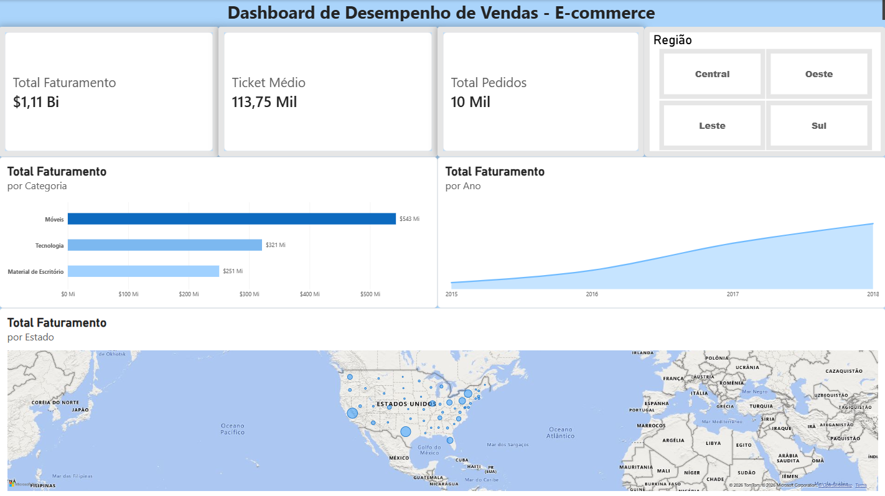

# 📊 Dashboard de Desempenho de Vendas - E-commerce


---

## 📌 Visão Geral do Projeto

Este projeto consiste em um **Dashboard Interativo de Inteligência Comercial** desenvolvido para analisar o desempenho de vendas e faturamento de uma empresa de e-commerce. O painel permite explorar os resultados de forma macro ou segmentada por **Região**, **Estado**, **Categoria de Produto** e **Evolução Temporal**.

O objetivo principal é fornecer à equipe de gestão insights rápidos sobre a distribuição geográfica da receita, tíquete médio e comportamento do faturamento ao longo dos anos.

---

## 🖼️ Visualização do Dashboard

## Visão Geral (Geral de Vendas)
> Painel consolidado com indicadores globais de faturamento, pedidos e tíquete médio.

---
## 📈 Principais Indicadores (KPIs) e Visualizações

* **KPIs Principais:**
  * 💰 **Total de Faturamento:** R$ 1,11 Bilhão (faturamento acumulado do período)
  * 💳 **Ticket Médio:** R$ 113,75 Mil por pedido
  * 📦 **Total de Pedidos:** 10 Mil pedidos realizados

* **Visualizações Dinâmicas:**
  * **Faturamento por Categoria (Gráfico de Barras):** Destaque para as categorias de *Móveis*, *Tecnologia* e *Material de Escritório*.
  * **Evolução Temporal do Faturamento (Gráfico de Linha):** Acompanhamento do crescimento contínuo da receita entre 2015 e 2018.
  * **Distribuição por Estado (Gráfico de Barras Horizontais):** Mapeamento dos principais estados em faturamento, com destaque para *Califórnia*, *Texas* e *Nova York*.
  * **Filtro Regional (Segmentação de Dados):** Botões interativos para filtrar os dados pelas regiões *Central*, *Oeste*, *Leste* e *Sul*.

---

## 🛠️ Tecnologias e Ferramentas Utilizadas

* **Visualização de Dados:** Power BI (Modelagem de dados, Relatórios Interativos e DAX).
* **Banco de Dados & Consultas:** SQL Server (Validação de dados, consultas de agregação e filtros via scripts SQL).
* **Fonte de Dados:** Base de dados relacional / CSV (`arquivo.csv`) contendo registros de pedidos, categorias, localidades e faturamento.

---

## 🔍 Consultas SQL de Suporte (ETL / Validação)

Durante o projeto, a base foi analisada e validada via consultas SQL (`consultas_consultas.sql`):

```sql
USE ProjetoEcommerce;
GO

-- 1. Ver as primeiras 10 linhas da tabela para confirmar a estrutura
SELECT TOP 10
	Order_ID,
	Order_Date,
	Customer_Name,
	State,
	Category,
	Sales
FROM VendasEcommerce;

-- 2. Calcular o faturamento Total e a Quantidade Total de Vendas
SELECT
	COUNT(Order_ID) AS Total_Pedidos,
	SUM(Sales) AS Faturamento_Total
FROM VendasEcommerce;

-- 3. Descobrir o Faturamento por Categoria de Produto
SELECT
	Category,
	SUM(Sales) AS Faturamento_Categoria
FROM VendasEcommerce
GROUP BY Category
ORDER BY Faturamento_Categoria DESC;
